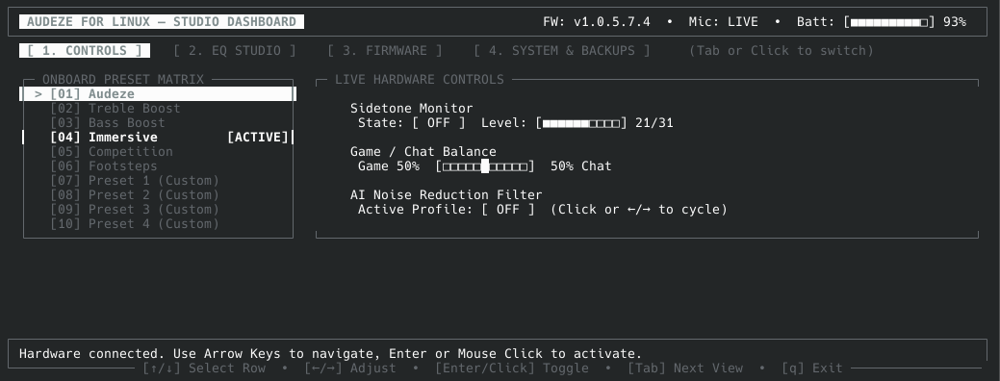
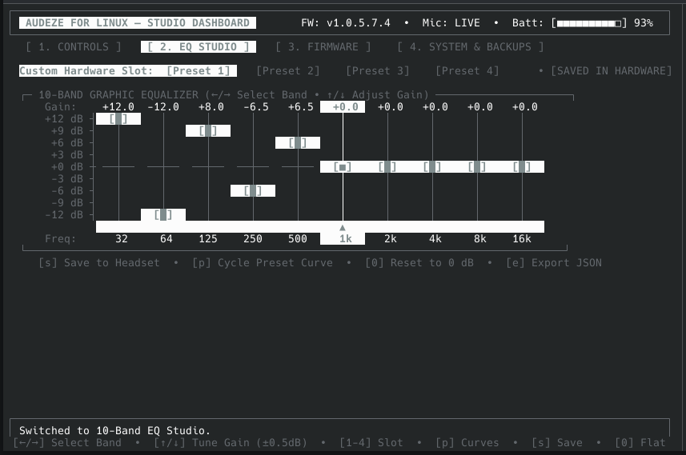
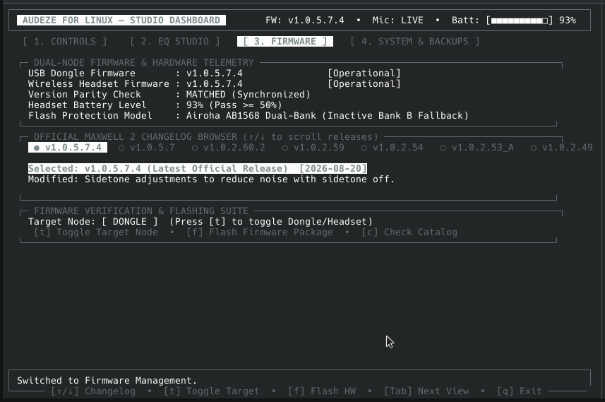
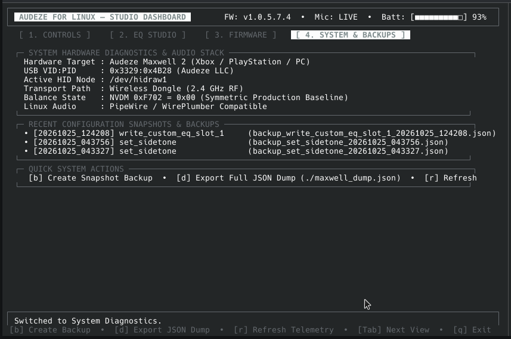

<h1 align="center">Audeze for Linux</h1>

<p align="center">
  <a href="https://github.com/junaydirfan/audezeforlinux/actions/workflows/codeql.yml"></a>
  <a href="https://python.org"></a>
  <a href="https://pipewire.org"></a>
  <a href="LICENSE"></a>
</p>

<p align="center"><strong>The definitive native Linux companion and studio control suite for Audeze Maxwell 2 & 1 gaming headsets.</strong></p>

<!-- Hero Demo Video or Animated GIF:
     Replace the link below with your uploaded GitHub release asset or demo video URL:
     Example: https://github.com/junaydirfan/audezeforlinux/assets/.../dashboard_demo.mp4 -->

<p align="center">
  <a href="#interactive-live-studio-dashboard"></a>
</p>

<p align="center">
  <a href="#quick-start">Quick Start</a> ·
  <a href="#show-dont-tell-studio-features">Studio Features</a> ·
  <a href="#supported-hardware">Supported Hardware</a> ·
  <a href="#firmware-diagnostics--safety-suite">Firmware Suite</a> ·
  <a href="#distro-compatibility--system-doctor">Distro Doctor</a> ·
  <a href="#documentation">Documentation</a>
</p>

---

**Audeze for Linux** (`audezeforlinux`) gives Linux gamers, audiophiles, and sound engineers native hardware-level control over their **Audeze Maxwell 2** and **Maxwell 1** headsets. Built with zero external dependencies in pure Python, it operates out-of-the-box on **Arch Linux, CachyOS, Fedora, Ubuntu, Debian, openSUSE, and Steam Deck**.

No proprietary Windows or macOS companion apps required. Configure custom 10-band graphic EQ curves, switch factory presets, fine-tune sidetone and Game/Chat balance, inspect firmware releases, and verify hardware safety directly from a high-performance terminal UI or command line.

---

## Show, Don't Tell: Studio Features

Every feature is designed around safe, low-latency communication over Linux `hidraw` USB endpoints.

### Interactive Live Studio Dashboard (TUI)
A unified 4-tab keyboard and mouse-driven terminal studio. Monitor real-time battery status, live mic mute switch, dongle firmware, and toggle all 10 onboard presets and hardware sliders in real-time.

**Keybindings:** `Tab` switch views · `↑`/`↓` row cursor · `←`/`→` adjust sliders · `Enter` toggle

<p align="center">
  
</p>

### Horizontal 10-Band Graphic Equalizer
A true DAW-style horizontal graphic EQ (32 Hz to 16 kHz). Tune in precision ±0.5 dB steps (-12.0 dB to +12.0 dB), cycle pre-tuned audiophile targets (*Harman Target*, *FPS Footsteps*, *Bass Boost*, *V-Shape*, *Vocal Clarity*), and write custom curves directly to headset hardware NVDM memory.

**Keybindings:** `←`/`→` select frequency · `↑`/`↓` gain dB · `1`–`4` custom slots · `s` save to hardware

<p align="center">
  
</p>

### Firmware Diagnostics & Pre-Flight Flasher
Live dual-node telemetry monitoring Dongle & Headset version parity, battery safety reserve (>30%), and transport routes. Browse the complete official Maxwell 2 changelog (`v1.0.5.7.4` to `v1.0.2.49`) with keyboard scrolling, and flash updates protected by Airoha dual-bank recovery.

**Keybindings:** `↑`/`↓` scroll changelog · `r` refresh telemetry

<p align="center">
  
</p>

### Automated Pre-Write Backups & Dry-Run Safety
Before any hardware change (preset, EQ curve, sidetone, chat mix) is transmitted to hardware memory, a timestamped snapshot is saved to `~/.config/maxwell2/backups/`. Every command supports `--dry-run` to inspect exact hex report packets without hardware writes.

**Run:** `./audezeforlinux backup list` · `./audezeforlinux --dry-run status`

<p align="center">
  
</p>

---


## Quick Start

`audezeforlinux` has **zero external package dependencies** (uses only the Python standard library) and requires no compilation.

### 1. Automated Setup (1 Step)
Run the automated configuration to grant your normal user account non-root access to the headset and install the application shortcut:

```bash
# Clone the repository
git clone https://github.com/junaydirfan/audezeforlinux.git
cd audezeforlinux

# 1. Install udev rules for non-root hardware access (auto-prompts sudo & reloads udev)
./audezeforlinux setup-udev

# 2. Install desktop launcher and user PATH symlink (~/.local/bin/audezeforlinux)
./audezeforlinux install-system

# 3. Verify your Linux audio environment and device permissions
./audezeforlinux doctor
```
*(Unplug and replug the USB dongle once after running `setup-udev`).*

### 2. Launch the Interactive Studio Dashboard
```bash
audezeforlinux dashboard
# or from the cloned directory:
./audezeforlinux dashboard
```

---

## Supported Hardware

| Headset / Dongle Model | USB VID:PID | Connection Interface | Status |
| :--------------------- | :---------: | :------------------: | :----: |
| **Maxwell 2 (Xbox Dongle)** | `3329:4B28` | Wireless 2.4 GHz Dongle | **Verified & Tested (Active)** |
| **Maxwell 2 (PlayStation / PC Dongle)** | `3329:4B29` | Wireless 2.4 GHz Dongle | Supported |
| **Maxwell 2 (Direct USB-C)** | `3329:4B2A` | Direct USB Audio / HID | Supported |
| **Maxwell 1 (Xbox Dongle)** | `3329:4B18` | Wireless 2.4 GHz Dongle | Supported |
| **Maxwell 1 (PlayStation Dongle)** | `3329:4B19` | Wireless 2.4 GHz Dongle | Supported |
| **Maxwell 1 (PlayStation USB-C)** | `3329:4B1A` | Direct USB Audio / HID | Supported |
| **Maxwell 1 (Xbox USB-C)** | `3329:4B1E` | Direct USB Audio / HID | Supported |

---

## Command-Line Interface (CLI) Quick Reference

For scripting, shortcuts, and headless configurations, every feature is also accessible via standard CLI subcommands:

### 1. Real-time Status & Telemetry
```bash
# Rich terminal status table (Battery gauge, preset, mic switch, sidetone, balance)
audezeforlinux status

# Export raw machine-readable JSON status for scripts or polybar/waybar:
audezeforlinux status --json
```

### 2. Equalizer & Presets
```bash
# List all 10 onboard presets (6 factory + 4 custom hardware slots)
audezeforlinux eq list

# Switch active preset by name or index
audezeforlinux eq preset "Immersive"
audezeforlinux eq preset 3

# Read custom EQ curve from hardware Slot 1
audezeforlinux eq get 1

# Apply a custom 10-band curve to hardware Slot 1 (32Hz to 16kHz)
audezeforlinux eq set 1 "2.5, 1.5, 0.0, -1.0, 0.5, 1.0, 2.0, 3.0, 1.5, 0.0"
```

### 3. Hardware Audio Controls
```bash
# Adjust Sidetone monitor (0 = Muted, 1..31 = Volume)
audezeforlinux sidetone level 21
audezeforlinux sidetone off
audezeforlinux sidetone on

# Balance Game and Chat audio (0 = 100% Game, 50 = 50/50 Balance, 100 = 100% Chat)
audezeforlinux chatmix 50
```

### 4. Firmware Diagnostics & Safety Suite
```bash
# Dual-node version parity verification and battery safety gate
audezeforlinux firmware status

# Check official Audeze release catalog and changelogs against installed version
audezeforlinux firmware check

# Inspect an official .bin firmware package (SHA-256 partition verification)
audezeforlinux firmware inspect path/to/maxwell_firmware.bin

# Stream firmware update with dual-bank recovery safety (dry-run by default)
audezeforlinux firmware flash path/to/maxwell_firmware.bin --target dongle --dry-run
```

### 5. Diagnostics & Automated Backups
```bash
# Run comprehensive Linux audio stack doctor
audezeforlinux doctor

# List pre-write configuration snapshots
audezeforlinux backup list

# Export complete headset configuration and all 4 custom EQ slots
audezeforlinux dump --out maxwell_backup.json
```

---

## Code Quality & Automated Security Scanning

To maintain production stability and security, `audezeforlinux` incorporates continuous automated code scanning:

1. **GitHub CodeQL (Static Analysis & Vulnerability Scanning)**:
   - Evaluated weekly and on every pull request via [.github/workflows/codeql.yml](.github/workflows/codeql.yml).
   - Scans Python code against OWASP vulnerabilities, CWE security risks, and unsafe buffer operations.
2. **SonarCloud / SonarQube Quality Gate**:
   - Analyzes cognitive complexity, code duplication, and maintainability ratings.
   - To link your SonarCloud project, add your `SONAR_TOKEN` to your GitHub repository secrets and enable the SonarCloud GitHub app.
3. **Ruff & Python Typing**:
   - Zero-dependency architecture strictly validated across Python 3.8, 3.9, 3.10, 3.11, 3.12, and 3.13 via [.github/workflows/ci.yml](.github/workflows/ci.yml).

---

## Safety-First Architecture

1. **Grounded in Official Hardware Truth**: No experimental or non-functional opcodes. Only genuine, verified Audeze Maxwell 2 features are implemented.
2. **Strict Packet Validation**: Outgoing packets are validated against strict length and range envelopes before transmission to `/dev/hidraw`.
3. **Automated Pre-Write Snapshots**: Modifying any hardware state triggers an automatic backup snapshot in `~/.config/maxwell2/backups/`.
4. **Dry-Run Mode**: Test commands with `--dry-run` to print exact hex reports without touching physical hardware.

---

## Documentation

- [docs/PROTOCOL.md](docs/PROTOCOL.md): Detailed breakdown of Airoha RACE protocol framing, opcode reference, and memory layouts.
- [docs/DEVICE.md](docs/DEVICE.md): USB interface tree, endpoint addresses, and report descriptor breakdown.
- [docs/FIRMWARE.md](docs/FIRMWARE.md): Firmware architecture, partition hashes, and dual-bank safety model.
- [docs/CAPTURE_WORKFLOW.md](docs/CAPTURE_WORKFLOW.md): USB packet capture and isolation methodology.
- [docs/NOTES.md](docs/NOTES.md): Hardware discovery log and technical observations.

---

## License

This project is licensed under the [MIT License](LICENSE).
Copyright (c) 2026 Junayd Irfan and contributors.
